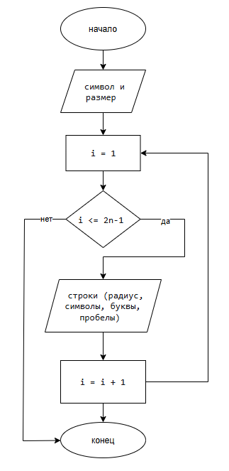

# Лабораторная работа №9 (Вариант 16)
  
Студент: Полякова В.Д.
Группа: бТИИ-261

## Задание

Написать программу, выводящую на экран заданную
геометрическую фигуру, нарисованную с помощью заданного с клавиатуры
символа, условие заполнения фигуры и задаваемые параметры фигуры в
таблице (остальные можно взять константные)

**Требуется:**
1. Составить блок-схему алгоритма решения.
2. Написать программу на языке C.

## Блок-схема

